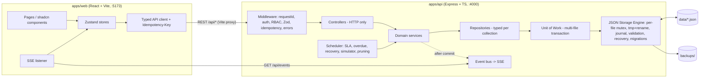

# Yash Earthing CRM — Architecture Proposal (Local JSON Version)

Status: **PROPOSAL — awaiting approval. No implementation yet.**
Source requirements: `PRD.md` ("ENTERPRISE PROMPT v3 – LOCAL CHECKING VERSION") + the stack/storage override message.

---

## 0. Inputs, precedence and deviations from PRD.md

Precedence: **override message > PRD.md edge cases > PRD.md rules.**

| #   | PRD.md says                                                                                      | This design does                                                                                                                                    | Why                            |
| --- | ------------------------------------------------------------------------------------------------ | --------------------------------------------------------------------------------------------------------------------------------------------------- | ------------------------------ |
| D1  | No backend, localStorage is the live DB, Dexie optional                                          | Express API is the only reader/writer of business data; root `data/*.json` via `fs/promises`. Browser stores only the demo session token + UI prefs | Override §2–3                  |
| D2  | Seed JSON in `src/data/`, `db.ts` service in the browser                                         | Seed generator in `apps/api/src/seed/`; storage engine + repositories in `apps/api`                                                                 | Override §2, §7                |
| D3  | Acceptance #6: `src/pages, src/components, src/store, src/db, src/services, src/utils, src/data` | Same folders under `apps/web/src` (minus `db`, `data`); storage in `apps/api/src/storage`                                                           | Monorepo layout (override §7)  |
| D4  | `quotes.json`                                                                                    | `quotations.json`                                                                                                                                   | Override naming                |
| D5  | `products.json` holds stock                                                                      | `products.json` = catalogue, `inventory.json` = stock                                                                                               | Override lists both            |
| D6  | —                                                                                                | Extra files `timeline.json`, `actions.json` (idempotency) from PRD §12; masters inside `settings.json`                                              | PRD §12 requires them          |
| D7  | Framer Motion                                                                                    | Omitted (Tailwind transitions)                                                                                                                      | Not in strict stack            |
| D8  | "25 customers"                                                                                   | Derived: 25 distinct companies across the 60 seeded leads (no `customers.json`)                                                                     | PRD §12 has no customer entity |

---

## 1. Architecture diagram



Request flow (mutation):

```
HTTP → requestId → authenticate(token → user from users.json) → requirePermission(perm)
     → validate(Zod) → idempotency(actions.json) → controller → service.method(actor, input)
         → uow.transaction([collections]) { rules, scope checks, audit, timeline, notifications }
         → commit (validate → tmp → fsync → journal → rename → swap cache)
     → event bus → SSE push → JSON response
```

Principles

- **Single writer**: only the API process touches `data/` (one API instance; documented limitation).
- Services own rules; controllers never touch repositories; repositories hold no business rules.
- **No business logic in the browser.** Guardrail state comes from the API as `allowedActions[]` (`{action, enabled, reason}`) so disabled buttons + tooltips are server-driven. Quote live totals use `POST /api/quotations/preview-totals` (debounced) instead of a duplicated GST calculator.
- RBAC enforced on the server (route middleware + service scope filters); UI mirrors permissions from `/api/auth/me`.

---

## 2. Folder structure

```
leadmanagementinDevin/
├─ package.json                 # npm workspaces; scripts: dev, build, test, lint, typecheck, seed, reset
├─ tsconfig.base.json           # strict, noUncheckedIndexedAccess
├─ eslint / prettier / .editorconfig / .gitattributes (LF)
├─ .github/workflows/ci.yml     # lint + typecheck + test + build
├─ PRD.md, README.md
├─ data/                        # live JSON (generated on first boot)
│  ├─ users.json leads.json timeline.json followups.json calls.json
│  ├─ quotations.json orders.json products.json inventory.json
│  ├─ invoices.json payments.json recovery.json targets.json
│  ├─ notifications.json audit.json settings.json actions.json
│  ├─ .bak/                     # last-good copy per file
│  └─ .journal/                 # in-flight transaction journals
├─ backups/                     # <YYYYMMDD-HHmmss>-<reason>/ + manifest.json ; corrupted/
├─ docs/  ARCHITECTURE.md API.md DATA-MODEL.md STORAGE-ENGINE.md WORKFLOWS.md RBAC.md SECURITY.md TESTING.md
├─ packages/contracts/          # (decision Q2) Zod schemas + inferred types + enums ONLY, no logic
└─ apps/
   ├─ api/src/
   │  ├─ server.ts              # boot: config → storage recover/migrate/seed → scheduler → listen
   │  ├─ app.ts                 # express app factory (tests use it)
   │  ├─ config/                # PORT, DATA_DIR, BACKUP_DIR, TOKEN_SECRET
   │  ├─ storage/  JsonFileStore.ts FileMutex.ts UnitOfWork.ts Journal.ts BackupManager.ts
   │  │            Recovery.ts DataTransfer.ts registry.ts migrations/
   │  ├─ repositories/          # LeadRepo, UserRepo, ... (find/filter/insert/update/softDelete in tx)
   │  ├─ services/ auth/ rbac/ leads/ (lifecycle, scoring, phone, duplicates, import, simulator)
   │  │            assignment/ attendance/ followups/ calls/ sla/ notifications/ audit/ timeline/
   │  │            quotations/ (gst, numbering, revisions) orders/ inventory/ dispatch/
   │  │            finance/ (invoices, payments, ageing) recovery/ targets/ reports/ dashboard/ settings/
   │  ├─ controllers/  routes/  middleware/ (requestId, authenticate, requirePermission, validate, idempotency, errorHandler)
   │  ├─ scheduler/ (runner + jobs)  events/ (bus + SSE hub)
   │  ├─ seed/                  # deterministic generator (fixed PRNG seed, timestamps relative to now)
   │  └─ utils/ ist.ts money.ts ids.ts csv.ts errors.ts
   │  └─ test/ unit/ integration/ storage/
   └─ web/
      ├─ vite.config.ts (proxy /api → :4000), tailwind, components.json (shadcn)
      └─ src/
         ├─ app/ (router, providers, layout)
         ├─ pages/ dashboard, leads/{inbox,my-leads,all,kanban,followups,calls,duplicates,lost,detail},
         │        quotations, orders, finance, targets, reports, team, admin, settings, access-denied
         ├─ components/ ui (shadcn), common (DataTable, EmptyState, ConfirmDialog, MoneyInput, PhoneInput,
         │             RequirePermission, ActionButton-with-reason-tooltip, skeletons), charts
         ├─ features/<module>/{components,hooks}
         ├─ store/ auth, ui, notifications, simulator, leads, followups, quotations, orders, finance ...
         ├─ services/api/ client.ts + one module per resource
         ├─ utils/ format-inr.ts format-ist.ts phone-display.ts cn.ts
         └─ test/
```

---

## 3. JSON schemas

All schemas are Zod; shown in TS notation. Conventions:

- IDs are human-readable codes. Timestamps ISO-8601 UTC; displayed and day-bucketed in **Asia/Kolkata (UTC+05:30)**.
- **Money stored as integer paise** (`...Paise`) to avoid float drift; shown as `Rs 1,23,456.00`.
- Phones stored E.164 `+919876543210`; displayed `+91 98765 43210`.
- Deletes are **soft** (`deletedAt`); lost leads are never deleted.

```ts
type BaseRecord = {
  id;
  createdAt;
  updatedAt;
  createdBy;
  updatedBy;
  version: number /*optimistic concurrency*/;
  deletedAt: string | null;
};
```

### 3.1 File envelope (every file)

```jsonc
{
  "collection": "leads",
  "schemaVersion": 1, // migrated on boot if older
  "revision": 128, // +1 on every committed write
  "updatedAt": "2026-11-14T06:45:00.000Z",
  "checksum": "sha256:...", // of "data"; mismatch => re-validate (hand edits allowed if valid)
  "meta": { "sequences": { "LD-261114": 3 } }, // code counters live in the SAME file + write
  "data": [], // settings.json: data is an object
}
```

### 3.2 Collections

```ts
// users.json
User = Base & { id:"USR-001"; name; email; phone; role:"ADMIN"|"SALES_MANAGER"|"SALES_EXECUTIVE"|"BACK_OFFICE";
  managerId|null; active; checkedIn; lastCheckInAt|null; lastCheckOutAt|null; maxActiveLeadsOverride:number|null }

// leads.json
Lead = Base & { id:"LD-261114-001"; company; companyKey; contactPerson; phoneRaw; phoneNormalized; alternatePhones:string[];
  email|null; city; state; address|null; gstin|null; gstinValid:boolean|null; productId|null; variant|null;
  expectedValuePaise; source:"DIRECT"|"JUSTDIAL"|"TRADEINDIA"|"WEBSITE"|"REFERRAL"|"EXCEL_IMPORT"; rawQuery|null; notes|null;
  status:"NEW"|"CONTACTED"|"QUALIFIED"|"QUOTE_REQUESTED"|"NEGOTIATION"|"WON"|"LOST";
  assignedTo|null; assignedAt|null; score; scoreBreakdown:{source;value;cityTier;responseSpeed;followups};
  nextFollowUpAt|null /*denormalized: earliest PENDING follow-up*/; firstContactedAt|null; slaDueAt|null; slaBreachedAt|null;
  wonAt|null; wonQuotationId|null; wonApproval:{approvedBy;reason;at}|null; wonApprovalRequest:{requestedBy;reason;at}|null;
  lostAt|null; lostReason:"PRICE_HIGH"|"COMPETITOR"|"NO_REQUIREMENT"|"NO_RESPONSE"|"BUDGET_ISSUE"|"OTHER"|null; lostNotes|null;
  possibleDuplicate; duplicateOfId|null; duplicateResolvedAt|null; mergedIntoId|null }

// timeline.json
TimelineEntry = { id:"TL-..."; leadId; type: CREATED|STATUS_CHANGED|ASSIGNED|REASSIGNED|UNASSIGNED|CALL_LOGGED|NOTE|
  FOLLOWUP_CREATED|FOLLOWUP_DONE|FOLLOWUP_RESCHEDULED|FOLLOWUP_SNOOZED|QUOTE_REQUESTED|QUOTE_STATUS|ORDER_CREATED|
  INVOICE_CREATED|PAYMENT_RECEIVED|MERGED|DUPLICATE_FLAGGED|SLA_BREACHED|WON_APPROVAL_REQUESTED|REOPENED|SCORE_CHANGED;
  payload; visibility:"PUBLIC"|"PRIVATE" /*exec private notes hidden from Back Office*/; actorId /*"SYSTEM" for jobs*/; actorRole; at }

// followups.json
FollowUp = Base & { id:"FU-..."; leadId; assignedTo; dueAt; type:"CALL"|"VISIT"|"WHATSAPP"|"EMAIL";
  status:"PENDING"|"DONE"|"CANCELLED"; note|null; rescheduleCount; snoozedUntil|null; completedAt|null; completedBy|null;
  outcomeNote|null; overdueNotifiedAt|null }

// calls.json
Call = Base & { id:"CL-..."; leadId; userId; outcome:"CONNECTED"|"BUSY"|"CALLBACK_REQUESTED"|"INVALID_NUMBER"|"NOT_REACHABLE";
  durationSec; notes|null; calledAt; nextFollowUpId|null }

// quotations.json (one record per revision)
Quotation = Base & { id:"QT-2026-0001-R0"; number:"QT-2026-0001"; revision; isLatest; previousRevisionId|null; leadId;
  requestedBy; requestNote|null; assignedTo /*Back Office*/;
  status:"DRAFT"|"UNDER_REVIEW"|"READY"|"SENT"|"ACCEPTED"|"REVISED"|"REJECTED"; customerState; taxMode:"INTRA"|"INTER";
  items:{lineId;productId;productName;hsn;unit;qty;ratePaise;discountPct;lineTotalPaise}[]; freightPaise;
  totals:{subtotalPaise;discountPaise;taxablePaise;cgstPaise;sgstPaise;igstPaise;freightPaise;grandTotalPaise};
  validUntil; terms; sentAt|null; acceptedAt|null; rejectedAt|null; rejectionReason|null; clonedFromId|null; orderId|null }

// orders.json
Order = Base & { id:"SO-2026-0001"; quotationId; leadId;
  status:"PENDING"|"APPROVED"|"PARTIALLY_DISPATCHED"|"DISPATCHED"|"DELIVERED"|"CANCELLED";
  lines:{lineId;productId;productName;qty;ratePaise;discountPct;reservedQty;shippedQty;invoicedQty}[]; totals;
  approvedAt|null; approvedBy|null; exception:{approvedBy;reason;at;shortages:{lineId;shortQty}[]}|null;
  dispatches:{dispatchId /*client UUID => idempotent*/;tripNo;at;by;vehicleNo|null;ewayBillNo|null;lines:{lineId;qty}[];invoiceId|null}[];
  deliveredAt|null; cancelledAt|null; cancelReason|null }

// products.json
Product = Base & { id:"PRD-001"; sku; name; category; hsn; unit; ratePaise; costPaise /*hidden from Exec*/; gstRatePct:18; active }

// inventory.json  (available = onHand - reserved, computed; invariant 0 <= reserved <= onHand)
StockItem = Base & { id:"PRD-001" /*= productId*/; onHand; reserved; lowStockAt }

// invoices.json
Invoice = Base & { id:"INV-2611-0001"; orderId; leadId; dispatchIds:string[]; invoiceDate; taxMode; lines; totals;
  ewayBillNo|null; vehicleNo|null; receivedPaise; balancePaise; status:"PENDING"|"PARTIAL_RECEIVED"|"FULL_RECEIVED" }

// payments.json
Payment = Base & { id:"PAY-..."; invoiceId; amountPaise; mode:"CASH"|"NEFT"|"RTGS"|"UPI"|"CHEQUE"; reference|null; receivedAt; recoveryId|null }

// recovery.json
RecoveryCase = Base & { id:"RC-..."; invoiceId; leadId; assignedTo; trigger:"AUTO_OVERDUE"|"MANUAL";
  status:"OPEN"|"PROMISED"|"DISPUTED"|"RECOVERED"|"CLOSED";
  calls:{id;at;by;outcome:"PROMISE_TO_PAY"|"CALL_AGAIN"|"DISPUTE"|"PAID_IN_FULL"|"UNREACHABLE";
         promisedAmountPaise|null /* <= balance */; promiseDate|null; notes|null}[]; nextActionAt|null; recoveredAt|null }

// targets.json  (achieved values computed at read time)
Target = Base & { id:"TG-..."; userId; periodType:"MONTHLY"|"QUARTERLY"; periodKey:"2026-11"|"2026-Q4";
  revenueTargetPaise; callsTarget; conversionTargetPct }

// notifications.json
Notification = Base & { id:"NT-..."; userId /*recipient*/; type: LEAD_ASSIGNED|LEAD_UNASSIGNED|SLA_BREACH|FOLLOWUP_OVERDUE|
  QUOTE_REQUESTED|QUOTE_STATUS|PAYMENT_OVERDUE|WON_APPROVAL_REQUESTED|NEEDS_ATTENTION|LOW_STOCK|DATA_RECOVERED;
  title; message; entityType; entityId; link /*deep link*/; read; readAt|null; dedupKey /*prevents spam*/ }

// audit.json (append-only; archived to backups/audit-archive above 20k entries)
AuditEntry = { id:"AU-..."; at; actorId; actorRole; action: CREATE|UPDATE|DELETE|RESTORE|STATUS_CHANGE|ASSIGN|REASSIGN|STOCK_EDIT|
  EXCEPTION_APPROVAL|PERMISSION_CHANGE|SETTINGS_CHANGE|IMPORT|EXPORT|RESET|LOGIN|CHECK_IN|CHECK_OUT;
  entityType; entityId; before|null; after|null /*changed fields only*/; reason|null; requestId }

// actions.json (idempotency ledger, pruned after 24h)
ActionRecord = { key; actorId; method; path; requestHash; statusCode; responseBody; createdAt }

// settings.json (data is a single object)
Settings = {
  company:{name;address;gstin;state:"Maharashtra";phone;email;bank:{name;account;ifsc;branch};quoteTerms:string[]};
  assignment:{roundRobinEnabled:true; checkedInOnly:true; maxActiveLeadsPerExec:15; slaHours:2; rrPointerExecutive|null; rrPointerBackOffice|null};
  scoring:{sourceWeights; valueBands:{minPaise;points}[]; cityTiers:Record<city,1|2|3>};
  inventory:{defaultLowStockAt:20}; finance:{recoveryAfterDays:30; gstOnFreight:false};
  simulator:{autoMode:false; intervalSec:20};
  permissions: Record<Role, Record<Module, boolean>>;   // Admin matrix; ADMIN.admin locked true (anti-lockout)
  masters:{leadSources; lostReasons; cities:{name;state;tier}[]; states};
  backups:{retention:30}; seed:{seedVersion; seededAt} }
```

---

## 4. API specification

Base `http://localhost:4000/api` (browser uses Vite proxy `/api`). JSON only.

- Success `{ "data": ..., "meta"?: { page, pageSize, total } }` · Error `{ "error": { "code", "message", "details"? } }`
- Headers: `Authorization: Bearer <demo-token>`; `Idempotency-Key: <uuid>` required on POST mutations (replay returns the original response + `Idempotent-Replay: true`); `X-Request-Id` echoed. Lists: `?page&pageSize&sort=field:asc`.

| HTTP | code                                                                                                                          | When                                                                              |
| ---- | ----------------------------------------------------------------------------------------------------------------------------- | --------------------------------------------------------------------------------- |
| 400  | `VALIDATION_ERROR`                                                                                                            | Zod failure (`details` = field errors)                                            |
| 401  | `UNAUTHENTICATED`                                                                                                             | missing/invalid demo token                                                        |
| 403  | `FORBIDDEN`                                                                                                                   | permission denied (out-of-scope record IDs return 404 to avoid leaking existence) |
| 404  | `NOT_FOUND`                                                                                                                   |                                                                                   |
| 409  | `VERSION_CONFLICT` · `DUPLICATE_PHONE` (`details.existingLeadId`) · `IDEMPOTENCY_MISMATCH`                                    |                                                                                   |
| 422  | `GUARDRAIL` (`details.missingSteps[]`) · `STOCK_SHORTAGE` (`details.shortages[]`) · `OVERPAYMENT` · `PROMISE_EXCEEDS_BALANCE` | business rules                                                                    |
| 503  | `STORAGE_ERROR`                                                                                                               | I/O failure (transaction aborted, nothing partially written)                      |

### Auth, attendance, users

| Method       | Path                                         | Permission  | Notes                                                                          |
| ------------ | -------------------------------------------- | ----------- | ------------------------------------------------------------------------------ |
| GET          | /auth/demo-users                             | public      | role-switcher list (active users)                                              |
| POST         | /auth/login                                  | public      | `{userId}` → `{token, user, permissions, modules}`                             |
| POST         | /auth/logout · GET /auth/me                  | any         | me = user + effective permissions                                              |
| POST         | /attendance/check-in · /attendance/check-out | Exec (self) | check-in drains unassigned queue; check-out flags open leads "needs attention" |
| GET          | /team                                        | team:view   | attendance + load vs capacity (Exec: self)                                     |
| GET/POST/PUT | /users, /users/:id                           | Admin       | add, role change, activate/deactivate                                          |

### Leads

| Method       | Path                                               | Notes                                                                                                                                                             |
| ------------ | -------------------------------------------------- | ----------------------------------------------------------------------------------------------------------------------------------------------------------------- |
| GET          | /leads                                             | scoped; `q` (name/company/normalized phone), `source,status,assignedTo,city,from,to,scoreBand`, `view=inbox\|mine\|unassigned\|duplicates\|lost\|needs-attention` |
| POST         | /leads                                             | `duplicateAction?: "merge"\|"create_anyway"`; default blocks with 409 `DUPLICATE_PHONE`                                                                           |
| POST         | /leads/check-duplicate                             | `{phone}` → normalized + existing lead code                                                                                                                       |
| GET          | /leads/:id                                         | lead + `allowedActions[]` + follow-ups + calls + quotation summaries                                                                                              |
| PUT          | /leads/:id                                         | field edits (not status), requires `version`                                                                                                                      |
| DELETE       | /leads/:id                                         | Admin; soft delete, snapshot + audit                                                                                                                              |
| POST         | /leads/:id/assign                                  | Mgr/Admin; `{userId, reason}` reason mandatory                                                                                                                    |
| POST         | /leads/:id/status                                  | forward-only; 422 `GUARDRAIL` with missing steps                                                                                                                  |
| POST         | /leads/:id/won                                     | `{quotationId}` (ACCEPTED) or `{approvalReason}` (Mgr/Admin)                                                                                                      |
| POST         | /leads/:id/won-approval-request                    | Exec → notifies Manager                                                                                                                                           |
| POST         | /leads/:id/lost                                    | `{reason, notes}` mandatory                                                                                                                                       |
| POST         | /leads/:id/reopen                                  | Admin; `{reason}`                                                                                                                                                 |
| POST         | /leads/:id/merge                                   | `{targetLeadId}`; timeline on both                                                                                                                                |
| POST         | /leads/:id/notes                                   | `{text, visibility}`                                                                                                                                              |
| GET          | /leads/:id/timeline                                | `?type=`; PRIVATE redacted for Back Office                                                                                                                        |
| POST         | /leads/:id/followups · /leads/:id/calls            | call requires next follow-up unless lead closed                                                                                                                   |
| POST         | /leads/:id/quote-request                           | creates DRAFT quotation, round-robin to Back Office                                                                                                               |
| POST         | /leads/bulk                                        | `{action: status\|assign\|delete\|export, ids, payload}`; per-id results                                                                                          |
| POST         | /leads/import · GET /leads/import/template         | CSV → `{imported, skipped:[{row, errors}]}`                                                                                                                       |
| GET          | /leads/export.csv                                  | honours filters + scope                                                                                                                                           |
| GET/POST/PUT | /simulator · /simulator/generate · /simulator/auto | `{source}` · `{enabled}` single server timer                                                                                                                      |

### Follow-ups, calls, notifications, realtime

| Method   | Path                                                               | Notes                                                               |
| -------- | ------------------------------------------------------------------ | ------------------------------------------------------------------- |
| GET      | /followups                                                         | `bucket=today\|overdue\|upcoming`, `from,to` (calendar), scoped     |
| POST     | /followups/:id/done · /reschedule · /snooze                        | done requires next follow-up unless lead closed                     |
| GET      | /calls                                                             | global activity, scoped                                             |
| GET/POST | /notifications · /notifications/:id/read · /notifications/read-all | own only                                                            |
| GET      | /events                                                            | SSE: `notification`, `lead.changed`, `simulator.lead`, `data.reset` |

### Quotations

| Method | Path                                                                                       | Notes                                                      |
| ------ | ------------------------------------------------------------------------------------------ | ---------------------------------------------------------- |
| GET    | /quotations · /quotations/:id                                                              | Exec: own leads; Mgr: view all; BO/Admin: full             |
| POST   | /quotations/preview-totals                                                                 | live GST totals for the editor (no write)                  |
| PUT    | /quotations/:id                                                                            | DRAFT/UNDER_REVIEW/READY only; SENT ⇒ 422 "use Revise"     |
| POST   | /quotations/:id/submit-review · /mark-ready · /send · /accept · /reject · /revise · /clone | state machine                                              |
| GET    | /quotations/:id/print                                                                      | letterhead data → print view → browser Print / Save as PDF |
| POST   | /quotations/:id/convert-to-order                                                           | ACCEPTED latest revision only, once                        |

### Orders, inventory, products

| Method       | Path                               | Notes                                                                                   |
| ------------ | ---------------------------------- | --------------------------------------------------------------------------------------- |
| GET          | /orders · /orders/:id              |                                                                                         |
| POST         | /orders/:id/approve                | reserve all lines or 422 `STOCK_SHORTAGE` (per line)                                    |
| POST         | /orders/:id/approve-exception      | Mgr/Admin `{reason}`; reserves available, records backorder                             |
| POST         | /orders/:id/reserve                | top-up reservation after stock arrives                                                  |
| POST         | /orders/:id/dispatch               | `{dispatchId, lines[{lineId, qty}], vehicleNo, ewayBillNo}`; idempotent by `dispatchId` |
| POST         | /orders/:id/deliver · /cancel      | cancel releases unshipped reservation                                                   |
| POST         | /orders/:id/invoice                | invoices dispatched-but-uninvoiced qty                                                  |
| GET/PUT      | /inventory · /inventory/:productId | edit `{onHand, lowStockAt, reason, version}` BO/Admin; onHand ≥ reserved                |
| GET/POST/PUT | /products(/:id)                    | write Admin; `costPaise` redacted for Exec                                              |

### Finance, recovery, targets, reports, dashboard

| Method       | Path                                                                                            | Notes                                                                                                       |
| ------------ | ----------------------------------------------------------------------------------------------- | ----------------------------------------------------------------------------------------------------------- |
| GET          | /invoices · /invoices/:id                                                                       | ageing bucket computed                                                                                      |
| POST         | /invoices/:id/payments                                                                          | `{amountPaise}` or `{percent: 25\|50\|75\|100}` (of grand total, must be ≤ balance) or `{payBalance: true}` |
| GET          | /payments                                                                                       | list + ageing summary 0-30/31-60/61-90/90+                                                                  |
| GET/POST     | /recovery · /recovery/:id/calls · /recovery/:id/paid-in-full · /recovery/:id/close              |                                                                                                             |
| GET/POST/PUT | /targets                                                                                        | Exec own read; Mgr team write; Admin all                                                                    |
| GET          | /reports/funnel · /sources · /leaderboard · /followup-compliance · /recovery · /product-revenue | `from,to,format=csv`                                                                                        |
| GET          | /dashboard                                                                                      | role-shaped payload (PRD §9)                                                                                |

### Admin & data

| Method   | Path                                                                                             | Notes                                                         |
| -------- | ------------------------------------------------------------------------------------------------ | ------------------------------------------------------------- |
| GET/PUT  | /settings · /settings/assignment · /settings/permissions · /settings/masters · /settings/company | Admin (Mgr reads assignment)                                  |
| GET      | /audit                                                                                           | `entityType, entityId, actorId, action, from, to`             |
| GET      | /data/export                                                                                     | full bundle                                                   |
| POST     | /data/import                                                                                     | `?dryRun=true` validation report, then apply (snapshot first) |
| POST     | /data/reset                                                                                      | snapshot → reseed                                             |
| GET/POST | /data/backups · /data/backups/:id/restore                                                        |                                                               |
| GET      | /health                                                                                          | storage status, recovery events, file revisions               |

---

## 5. JSON storage engine design

```
Repositories (typed, per collection)
  └─ UnitOfWork.transaction(collections[], fn)      ← the ONLY write path
       └─ JsonFileStore (one per file): cache · validate · atomic write
            ├─ FileMutex (per file, FIFO promise queue)
            ├─ Journal (data/.journal)
            ├─ BackupManager (data/.bak, backups/)
            └─ Recovery + Migrations (boot)
```

### 5.1 Write path (no unsynchronized read-modify-write)

```ts
await uow.transaction(["audit", "leads", "notifications", "settings", "timeline", "users"], async (tx) => {
  const lead = tx.leads.insert({ ... });   // drafts are clones of committed state
  tx.settings.update(s => { ... });        // e.g. round-robin pointer
  tx.audit.append({ ... });
});
```

1. **Lock** each requested file's `FileMutex` in canonical (alphabetical) order → no deadlocks; same-file writes serialize FIFO, different files run in parallel.
2. Callback receives drafts of the committed in-memory state (engine is the single writer). Code counters (`meta.sequences`) increment in the same draft → numbering generated inside the same write.
3. Callback throws ⇒ drafts discarded, **disk untouched**.
4. **Validate** changed collections: Zod + invariants (e.g. `reserved ≤ onHand`). Failure ⇒ abort.
5. **Prepare**: write `<file>.tmp-<txnId>` → `fsync` → close, per file.
6. **Journal** `data/.journal/<txnId>.json` `{files:[{tmp,target}], state:"prepared"}` + fsync.
7. **Last-good backup**: copy target → `data/.bak/<file>.bak`.
8. **Commit**: `rename(tmp → target)` per file (Windows: retry with backoff on `EPERM/EBUSY/EACCES`).
9. Delete journal; **swap all in-memory caches synchronously** (readers never see half a transaction); bump `revision`, `checksum`.
10. Release locks; publish SSE events only after commit.

Reads are lock-free against the committed cache and return cloned/frozen objects.

### 5.2 Boot & corrupted-file recovery

1. Ensure `data/`, `data/.bak`, `data/.journal`, `backups/`.
2. **Roll forward** journals (tmp files were fully fsynced before the journal existed); delete orphan `*.tmp-*` without a journal.
3. Per file: parse → envelope schema → record schemas → invariants.
   - Checksum mismatch but valid ⇒ accept (hand-editing allowed for checking), recompute, warn.
   - **Corrupted** ⇒ move to `backups/corrupted/<ts>-<file>`; fallback chain `.bak` → newest valid snapshot → seed for that collection; Admin `DATA_RECOVERED` notification + audit + `/health`.
   - Missing ⇒ seed (first run seeds everything).
4. **Migrations**: older `schemaVersion` ⇒ snapshot, run ordered `migrations/<collection>/vN_to_vN+1`, write.
5. Start scheduler, listen.

### 5.3 Backups

- Last-good `.bak` per file on every commit.
- Snapshots `backups/<YYYYMMDD-HHmmss>-<reason>/` (all files + `manifest.json`: reason, actor, revisions, checksums) automatically before import, reset, restore, delete/bulk delete, permission change, migration, and first write of each IST day. Retention 30 (setting).

### 5.4 Versioning, concurrency, idempotency

- File `schemaVersion` (migrations) + `revision` (write counter); record `version` → stale update ⇒ 409 (UI: "changed by someone else — reload").
- `Idempotency-Key` stored in `actions.json` **inside the same transaction** as the business write; plus domain keys (`dispatchId`, one order per quotation, notification `dedupKey`).

### 5.5 Import / export / reset

- Export bundle `{format:"yash-crm-export", exportedAt, appVersion, schemaVersions, collections}`.
- Import: parse → migrate → Zod → referential integrity (assignees, leadIds, quote/order links, stock invariants) → dry-run report → snapshot → replace all in one transaction.
- Reset: snapshot → deterministic seed (timestamps relative to now so ageing/overdue/SLA widgets are realistic) → replace → SSE `data.reset`.

### 5.6 Documented limits

Single process/machine; whole-file rewrite per commit (fine at demo scale); audit archived above 20k entries; no encryption; not protection against disk failure.

---

## 6. Business workflow design

### 6.1 Lead capture

1. Phone: strip spaces/dashes/brackets; accept `XXXXXXXXXX` (starts 6–9), `0XXXXXXXXXX`, `91XXXXXXXXXX`, `+91XXXXXXXXXX` ⇒ `+91XXXXXXXXXX`; otherwise inline field error, not saved.
2. GSTIN (optional) `^\d{2}[A-Z]{5}\d{4}[A-Z][1-9A-Z]Z[0-9A-Z]$` ⇒ `gstinValid=false` + inline warning, not blocked.
3. JustDial self-filter: `companyKey` = lowercase, alphanumerics only, `privatelimited`→`pvtltd`; equals `yashearthingsolutionspvtltd` ⇒ dropped (`{dropped:true, reason}` reported by simulator/import).
4. Duplicate on `phoneNormalized` (incl. `alternatePhones`, excl. deleted): default 409 ⇒ modal "This phone already exists as LD-XXXX" → **Merge** (append phone/notes/raw query to existing, timeline on both, no new lead) or **Create Anyway** (`possibleDuplicate=true`, `duplicateOfId`, shows in `/leads/duplicates`; Mgr/Admin resolves: merge or mark not-duplicate).
5. Code `LD-YYMMDD-XXX` (IST date) from `meta.sequences` in the same write.
6. Score, round-robin (6.2), SLA clock, timeline `CREATED`, audit, notifications — one transaction.

- CSV import: each row validated independently; valid rows go through 1–6 (duplicates flagged, not merged); invalid rows returned with row number + reasons — never silently dropped. Sample template download.
- Simulator: one lead per source button; Auto Mode = single server interval (20s), cleared on disable and on shutdown, state in `settings.simulator`; new leads pushed via SSE (toast + inbox badge).

### 6.2 Assignment engine

```
eligible = role=EXEC ∧ active ∧ (checkedIn if checkedInOnly) ∧ activeLeads < capacity
           activeLeads = assigned, not WON/LOST/deleted; capacity = override ?? settings (15)
sort eligible by id; pick first after rrPointerExecutive (wrap); store pointer in same txn
none ⇒ Unassigned + notify Managers (dedup) + nav badge
```

- **Queue drain** (oldest first) on: check-in, lead Won/Lost/deleted, reassignment away, rule/capacity change, each scheduler tick.
- Deactivated / checked-out exec with open leads: leads stay assigned, appear in Manager "Needs attention", bulk reassign.
- Manual reassign: reason mandatory; timeline "Assigned to Rahul More by Rajesh Patil – 'reason' at 10:32 AM" (IST). Exceeding capacity manually needs explicit confirm (logged).
- Round-robin off ⇒ new leads go Unassigned.

### 6.3 Lifecycle

```
NEW → CONTACTED → QUALIFIED → QUOTE_REQUESTED → NEGOTIATION → WON
any non-terminal ───────────────────────────────────────────→ LOST (reason + notes)
LOST ──(Admin reopen + reason)──→ previous status
```

| Transition        | Precondition (else 422 GUARDRAIL naming the missing step)                             |
| ----------------- | ------------------------------------------------------------------------------------- |
| → CONTACTED       | ≥1 call logged                                                                        |
| → QUALIFIED       | currently CONTACTED                                                                   |
| → QUOTE_REQUESTED | only via Request Quote                                                                |
| → NEGOTIATION     | latest quotation SENT (auto-advanced on send, actor SYSTEM)                           |
| → WON             | linked ACCEPTED quotation, or Mgr/Admin approval + reason (Exec can request approval) |

- Convert-to-Order auto-marks WON if not already (logged).
- Every open lead must have a PENDING follow-up: otherwise red banner, "no next action" counter on dashboards; logging a call requires the next follow-up.
- Score 0–100 recomputed on every lead event, breakdown stored: source ≤25, expected value ≤25, city tier ≤20, response speed ≤15 (first contact vs SLA), completed follow-ups ≤15. Hot ≥80 / Warm 50–79 / Cold <50. Weights in settings.

### 6.4 Follow-ups, calls, SLA, notifications

- Buckets by IST day: Overdue (worst first), Today, Upcoming. Done / Reschedule (reason, count) / Snooze (15m, 1h, tomorrow 10:00).
- Call log: outcome, duration, notes, next follow-up; INVALID_NUMBER suggests Mark Lost; submit disabled while saving + idempotency key.
- SLA: `slaDueAt = assignedAt + slaHours` (elapsed 24×7 hours); met by first call log; scheduler marks breach once ⇒ badge + Manager notification. Reassigning an uncontacted lead restarts the clock.
- Overdue follow-up ⇒ assignee notified once. Notifications written inside the business transaction; SSE after commit; bell unread count; click deep-links.

### 6.5 Quotations

- Request Quote ⇒ DRAFT assigned to next Back Office (round-robin), lead → QUOTE_REQUESTED, BO notified.
- DRAFT → UNDER_REVIEW → READY → SENT → ACCEPTED | REJECTED; SENT → REVISED via Revise.
- GST: customer state Maharashtra ⇒ CGST 9% + SGST 9%; else IGST 18%. Line = qty × rate × (1 − disc%); tax on taxable; freight added after tax (setting); rounding to paise half-up at line and tax level.
- Editing SENT ⇒ rejected; Revise creates `-R{n+1}` DRAFT, old becomes REVISED read-only. Clone = new number. Only ACCEPTED latest revision unlocks Convert to Order.
- Number `QT-YYYY-XXXX`. Print view: letterhead, items, GST split, terms, bank details.

### 6.6 Orders, inventory, dispatch

- Convert (once per quotation) ⇒ `SO-YYYY-XXXX` PENDING with copied lines.
- Approve: all lines `available ≥ qty` ⇒ reserve all, APPROVED; else 422 per-line shortage; Mgr/Admin Exception Approval (reason) reserves what's available, records backorder; `/reserve` tops up later.
- Dispatch trip (idempotent `dispatchId`): qty ≤ line pending and ≤ line reserved; `onHand −= qty`, `reserved −= qty`, `shippedQty += qty`; → PARTIALLY_DISPATCHED / DISPATCHED; low-stock notification.
- Cancel (before full dispatch) releases unshipped reservation. Deliver after DISPATCHED.
- Stock edit: BO/Admin, reason, audit; cannot set `onHand < reserved`.

### 6.7 Finance & recovery

- Invoice `INV-YYMM-XXXX` for dispatched-but-uninvoiced qty; GST recomputed on invoiced lines; E-Way bill + vehicle no.
- Payment: amount, 25/50/75/100% of grand total, or "Pay balance"; must be > 0 and ≤ balance (exact paise) else 422. PENDING → PARTIAL_RECEIVED → FULL_RECEIVED.
- Ageing from invoice date: 0–30 / 31–60 / 61–90 / 90+.
- Scheduler: age > 30 days ∧ balance > 0 ∧ no open case ⇒ RecoveryCase (round-robin BO) + `PAYMENT_OVERDUE` notification.
- Recovery call: outcome, promised amount ≤ balance, promise date. "Customer Paid Full" ⇒ payment for exact balance + invoice FULL_RECEIVED + case RECOVERED in one transaction.

### 6.8 Targets, reports, dashboards

- Targets per exec per month/quarter; achieved revenue (decision Q5), calls logged, conversion = Won ÷ (Won + Lost) closed in period.
- Reports computed on read: funnel, source performance, leaderboard, follow-up compliance (done on/before due ÷ due), recovery performance, product revenue; CSV export.
- `/dashboard` returns role-specific widgets (PRD §9).

### 6.9 Scheduler (in-process, 60s tick, non-overlapping, idempotent jobs)

`slaMonitor` · `overdueFollowupNotifier` · `recoveryGenerator` · `unassignedQueueDrain` · `idempotencyPrune` · `dailySnapshot`; `simulatorAuto` on its own 20s timer.

---

## 7. Security & RBAC

- Permissions `module:action[:scope]` (e.g. `leads:read:own|team|all`, `leads:assign`, `inventory:edit`). Static role → permission ceiling in code; Admin Permissions Matrix (`settings.permissions`) can only remove module access below the ceiling, never escalate; Admin's own Admin module cannot be disabled (anti-lockout).
- Enforcement: `requirePermission()` on every route **and** service-level `scopeFilter(actor)` on every list/get/mutate — Exec: `assignedTo = self`; Manager: team (`managerId`) + unassigned; Back Office: no lead lists, only lead summaries embedded in quotes/orders/invoices; Admin: all. Out-of-scope IDs ⇒ 404.
- Field redaction: `costPaise`/margins hidden from Exec; PRIVATE notes hidden from Back Office.
- UI: `can()` from `/auth/me` drives sidebar, routes (`<RequirePermission>` → Access Denied card + Go Back) and buttons. Role switcher = `POST /auth/login` as another seeded user; stores refetch instantly.
- Demo auth: HMAC-SHA256 signed token `{userId, iat}` (Node `crypto`, secret from env with dev default); user reloaded from `users.json` per request so deactivation/role changes apply immediately. helmet, JSON body limit, CORS localhost only.
- `docs/SECURITY.md` + README will state clearly: **demo authentication and local JSON storage are NOT production-grade** (no passwords, plaintext files, single process, no encryption, no off-machine backups).

---

## 8. Testing plan

| Layer           | Tooling                                                                                                                                                     | Coverage                                                                                                                                                                                                                                                                                                                                                                                                                                                                                                                                 |
| --------------- | ----------------------------------------------------------------------------------------------------------------------------------------------------------- | ---------------------------------------------------------------------------------------------------------------------------------------------------------------------------------------------------------------------------------------------------------------------------------------------------------------------------------------------------------------------------------------------------------------------------------------------------------------------------------------------------------------------------------------- |
| Storage engine  | Vitest, real temp dirs                                                                                                                                      | 200 concurrent inserts ⇒ none lost; parallel multi-file txns, no deadlock; callback throw ⇒ disk unchanged; crash after prepare ⇒ roll-forward; orphan tmp cleanup; corrupted JSON ⇒ `.bak` ⇒ snapshot ⇒ seed; valid hand-edit accepted; migrations; Windows rename retry; import dry-run/validation; reset                                                                                                                                                                                                                              |
| Domain services | Vitest unit                                                                                                                                                 | phone table; GSTIN; JustDial filter; merge / create-anyway; round-robin order + pointer, capacity skip, nobody checked in, drain on check-in/close; every illegal lifecycle transition; Won w/o quote; Lost reason; reopen; scoring bands; SLA breach once; IST day boundaries (23:59 / 00:00 IST); GST intra/inter + rounding; edit-sent ⇒ revise; reservation, shortage, exception, partial + idempotent dispatch, cancel release; invoice qty; overpayment at paise boundary; recovery generation + paid-in-full; targets/report math |
| API integration | Vitest + Supertest on `app.ts` with temp data dir                                                                                                           | every endpoint happy path + validation; **RBAC matrix test: every role × every route** ⇒ expected 2xx/403/404; scope leakage (Exec fetching another exec's lead by id); idempotency replay/mismatch; version conflict                                                                                                                                                                                                                                                                                                                    |
| Web             | Vitest + React Testing Library                                                                                                                              | `can()` / RequirePermission / Access Denied; disabled-with-reason buttons; form validation; submit disabled while saving; INR/IST formatters; stores                                                                                                                                                                                                                                                                                                                                                                                     |
| E2E             | Playwright (Chromium) against dev servers with temp data dir                                                                                                | PRD §14.2 full sequence; §14.3 edge cases incl. refresh persistence; §14.4 role test; fails on any browser console error                                                                                                                                                                                                                                                                                                                                                                                                                 |
| Phase gate      | `npm run lint && npm run typecheck && npm test && npm run build` (+ Playwright from Phase 2) + manual browser demo of the phase happy path, reported to you |                                                                                                                                                                                                                                                                                                                                                                                                                                                                                                                                          |

---

## 9. Implementation phases (one PR per phase; next phase only after the previous passes)

| Phase                                  | Scope                                                                                                                                                                                                                                                                                                                                                                                                                                                                                                                                                | Exit criteria                                                                                                                        |
| -------------------------------------- | ---------------------------------------------------------------------------------------------------------------------------------------------------------------------------------------------------------------------------------------------------------------------------------------------------------------------------------------------------------------------------------------------------------------------------------------------------------------------------------------------------------------------------------------------------- | ------------------------------------------------------------------------------------------------------------------------------------ |
| **1. Foundation**                      | npm-workspaces monorepo, strict TS, lint/format, CI; full storage engine (mutex, UoW, journal, atomic write, backups, recovery, migrations, import/export/reset) + tests; Zod contracts for all files; deterministic seed (6 users, 6 products, 60 leads / 25 companies, 15 quotations, 12 orders, 8 invoices, 10 recovery cases, follow-ups, calls, targets); demo auth + RBAC middleware; audit service; web shell (navy sidebar, header with role switcher, checked-in toggle, bell), routing + Access Denied; Settings → Export / Import / Reset | storage tests green; `npm run dev` serves :5173 + :4000; refresh persists; each role sees only its nav; corrupted-file recovery demo |
| **2. Lead core**                       | capture form, phone/GSTIN, JustDial filter, duplicates, round-robin + attendance + capacity + unassigned + needs-attention + reassign, Inbox + simulator, My/All Leads with search/filters, Lead Detail 3-pane + timeline + What To Do Next, scoring, lifecycle guardrails, Won/Lost/Reopen, CSV import                                                                                                                                                                                                                                              | no check-in ⇒ unassigned, capacity skip, duplicate modal, Lost reason, Won guard — all survive refresh                               |
| **3. Engagement**                      | follow-ups (list / kanban / calendar), calls, SLA, notifications + SSE + bell, Kanban pipeline, bulk actions + CSV export, Duplicates queue, Lost bucket                                                                                                                                                                                                                                                                                                                                                                                             | no-follow-up banner, SLA breach + overdue notifications                                                                              |
| **4. Quotations**                      | request → BO round-robin, editor + live GST, state machine, revisions, clone, print/PDF                                                                                                                                                                                                                                                                                                                                                                                                                                                              | intra/inter GST correct; edit-sent forces revise                                                                                     |
| **5. Orders & inventory**              | convert, approve/reserve, shortage + exception, multi-trip partial dispatch, deliver/cancel, inventory + low stock + audited stock edit                                                                                                                                                                                                                                                                                                                                                                                                              | no double deduction on resubmit; cancel releases reservation                                                                         |
| **6. Finance & recovery**              | invoices from dispatches, payments (% / amount / balance), overpayment block, ageing, auto recovery, recovery calls, paid-in-full                                                                                                                                                                                                                                                                                                                                                                                                                    | pay 50% → pay rest → closed; recovery path                                                                                           |
| **7. Admin, targets, reports, polish** | Admin Control Center (users, permission matrix, assignment rules, masters, audit log, data/backups), targets, reports + CSV, four role dashboards, responsive + empty states + skeletons, README + docs, full Playwright acceptance suite                                                                                                                                                                                                                                                                                                            | PRD §14 criteria 1–6 pass                                                                                                            |

---

## 10. Open decisions (defaults apply if you just approve)

1. **PRD-LOCAL.md** was not attached and is not in the repo; this plan uses `PRD.md` (titled "LOCAL CHECKING VERSION"). Default: PRD.md is the spec.
2. **`packages/contracts`** shared package (Zod schemas + types + enums only, no business logic) used by both apps. Default: **yes**. Alternative: strictly two apps, types duplicated in web.
3. **Framer Motion**: omitted (not in strict stack). Default: omit.
4. **Generated `data/*.json` and `backups/`**: git-ignored, created by seed on first run / `npm run reset`. Default: ignored.
5. **Target achieved revenue** = payments received on the exec's leads in the period. Alternative: Won order value. Default: payments received.
6. **Freight GST**: freight added after tax (PRD order "subtotal, tax, freight, grand total"), toggleable. Default: not taxed.
