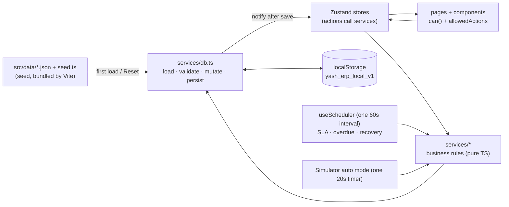

# Yash Earthing CRM — Architecture v2 (LOCAL CHECKING VERSION, browser-only)

Status: **PROPOSAL v2 — awaiting approval. No implementation yet.**
Spec: `PRD.md` (LOCAL CHECKING VERSION). v1 (Express + file storage) is kept as `ARCHITECTURE-v1-express.md` for a later production version.

**Hard constraints:** one React + Vite + TypeScript app · one server (Vite, port 5173) · no backend, no Express, no `/api`, no monorepo · seed data in `src/data/*.json` · live data in localStorage key `yash_erp_local_v1` · `src/services/db.ts` is the only module that touches localStorage.

Stack: React, Vite, TypeScript (strict), Tailwind CSS, shadcn/ui-style components, Zustand, React Router, Recharts, Framer Motion, Lucide React. Tests: Vitest + React Testing Library (Playwright only for the final end-to-end flow).

---

## 1. Architecture



Data flow: **UI component → Zustand store action → service (rules) → `db.ts` mutation → localStorage → store refresh → UI updates instantly.** Refresh reloads from localStorage, so data persists.

Layer rules

- Components never call services or `db.ts` directly; they call store actions and read store state.
- Services hold all business rules (lifecycle, assignment, GST, stock, payments) as plain TypeScript functions, so they are testable without React.
- `db.ts` is the only module that reads or writes localStorage. No component, store or service calls `localStorage` itself.
- RBAC is checked twice in the browser: `can()` hides or disables the UI, and every service function checks `can()` again before writing (PRD §4: "guard both layers").

---

## 2. Folder structure

```
leadmanagementinDevin/
├─ index.html  package.json  vite.config.ts  tsconfig.json  tailwind/postcss config  components.json
├─ eslint + prettier config, .github/workflows/ci.yml (lint + typecheck + test + build)
├─ PRD.md  README.md  docs/ARCHITECTURE.md
└─ src/
   ├─ main.tsx  App.tsx  router.tsx
   ├─ pages/
   │  ├─ dashboard/
   │  ├─ leads/ inbox, my-leads, all-leads, kanban, followups, calls, duplicates, lost, detail
   │  ├─ quotations/  orders/  finance/  targets/  reports/  team/  admin/  settings/
   │  └─ AccessDenied.tsx  NotFound.tsx
   ├─ components/
   │  ├─ ui/          shadcn-style primitives (button, dialog, table, tabs, toast, tooltip ...)
   │  ├─ layout/      Sidebar, Header (search, bell, simulator button, role switcher, checked-in toggle)
   │  ├─ common/      DataTable, EmptyState, ConfirmDialog, MoneyInput, PhoneInput, ActionButton (disabled + reason tooltip), Skeletons, RequirePermission
   │  └─ <module>/    LeadForm, LogCallModal, LostModal, QuoteEditor, DispatchModal, PaymentModal, RecoveryCallModal ...
   ├─ store/          Zustand: session (current user/role), ui, leads, followups, quotes, orders, finance, notifications, simulator, settings
   ├─ services/
   │  ├─ db.ts        ONLY localStorage access: load, validate, mutate, export, import, reset, backup
   │  ├─ permissions.ts   can(role, permission), module matrix, scope filters
   │  ├─ leads.ts  phone.ts  duplicates.ts  scoring.ts  lifecycle.ts  assignment.ts  attendance.ts
   │  ├─ followups.ts  calls.ts  sla.ts  notifications.ts  audit.ts  timeline.ts  simulator.ts  csvImport.ts
   │  ├─ quotes.ts  gst.ts  orders.ts  inventory.ts  invoices.ts  payments.ts  recovery.ts
   │  ├─ targets.ts  reports.ts  dashboard.ts  allowedActions.ts
   ├─ db/
   │  ├─ types.ts     all entity types + enums
   │  ├─ validate.ts  runtime validators for load/import
   │  └─ seedLoader.ts  builds the initial DB from src/data/*.json (shifts dates to "now")
   ├─ data/
   │  ├─ users.json leads.json quotes.json orders.json invoices.json payments.json recovery.json
   │  ├─ products.json targets.json audit.json settings.json
   │  └─ seed.ts      generates related follow-ups, calls, timeline and notifications from the JSON seed
   ├─ utils/          formatINR, ist (Asia/Kolkata dates), ids (LD/QT/SO/INV codes), money (paise), csv, cn
   └─ test/           setup (jsdom localStorage), fixtures
```

---

## 3. Local data store design (`services/db.ts`)

### 3.1 What is stored

One localStorage key, `yash_erp_local_v1`, holds the whole database as JSON:

```jsonc
{
  "schemaVersion": 1,
  "revision": 57, // +1 on every save
  "seededAt": "2026-11-14T06:45:00.000Z",
  "sequences": { "LD-261114": 3, "QT-2026": 15, "SO-2026": 12, "INV-2611": 8 },
  "collections": {
    "users": [],
    "leads": [],
    "timeline": [],
    "followups": [],
    "calls": [],
    "quotes": [],
    "orders": [],
    "products": [],
    "invoices": [],
    "payments": [],
    "recovery": [],
    "targets": [],
    "notifications": [],
    "audit": [],
    "actions": [],
  },
  "settings": {},
}
```

Other keys: `yash_erp_local_v1_backup` (last good copy, written before Reset, Import and bulk delete) and `yash_erp_session` (current demo user, so the role survives refresh).

### 3.2 Seed

- On first load (key missing), `seedLoader.ts` reads the bundled `src/data/*.json` files plus `seed.ts`, builds the DB, saves it, and sets `seededAt`.
- Seed JSON files store dates relative to `settings.anchorDate`. The loader shifts every date by (now − anchorDate), so overdue follow-ups, SLA breaches and invoice ageing always look realistic.
- Seed content (PRD §11): 6 users (1 Admin, 1 Manager, 3 Executives, 1 Back Office), 6 products with stock, 60 leads across all stages and score bands (25 distinct companies), 15 quotes, 12 orders, 8 invoices, 10 recovery cases, plus follow-ups, calls, timeline entries and targets.

### 3.3 Mutations

```ts
// the only write path
db.mutate((draft) => { ... }, { actionId?: string, label: string }) => Result
```

1. Reload from localStorage if another tab saved a newer `revision` (the `storage` event also triggers a reload).
2. Clone the current state into a draft; the service function edits the draft. Code counters (`sequences`) are incremented in the same draft, so LD/QT/SO/INV numbers are generated inside the same write.
3. If the function throws (guardrail, permission or validation error), the draft is discarded and nothing is saved.
4. Check invariants (e.g. `reserved <= onHand`, `received <= invoice total`, every open lead has a pending follow-up or an alert).
5. `JSON.stringify` → `localStorage.setItem`. A `QuotaExceededError` is caught, nothing changes, and the user sees a toast suggesting Export, then trimming old audit entries.
6. Swap the in-memory state, bump `revision`, notify the Zustand stores → UI updates instantly.

All of this is synchronous, so a single tab never has two writes interleaving.

### 3.4 Idempotency (PRD §2.1)

Every mutating store action takes an `actionId` (created when a form or modal opens). `db.mutate` first checks `collections.actions`: if the id is already there, it returns the stored result and does not run the change again. Submit buttons also disable while saving. Dispatch, payment, convert-to-order and lead creation all use this, so double-clicks or resubmits never create duplicates or deduct stock twice. Action records older than 24h are pruned.

### 3.5 Load, validation and recovery

- On start-up: parse → `validate.ts` (shape, enums, references) → migrate if `schemaVersion` is older.
- Invalid or unparseable data → restore `yash_erp_local_v1_backup` if it is valid, otherwise reseed. Either way, a toast tells the user what happened and an audit entry is written.

### 3.6 Settings → Data tools (PRD §2.1)

- **Export All Data JSON**: downloads the full `yash_erp_local_v1` value as `yash-erp-export-<date>.json`.
- **Import JSON**: choose a file → validate → show a preview (counts per collection, errors) → confirm → backup → replace.
- **Reset Demo Data**: confirm → backup → reseed from `src/data`.
- Shows storage used vs the ~5 MB browser limit. Audit is capped at the newest 5,000 entries (export first if you need more).

### 3.7 Time, money, phone

Timestamps are ISO strings; display and "today" boundaries use Asia/Kolkata (UTC+05:30). Money is stored as integer paise and shown as `Rs 1,23,456.00`. Phones are stored as `+91XXXXXXXXXX` and shown as `+91 98765 43210`. `tel:` and `wa.me` links degrade gracefully (copy-number fallback).

---

## 4. Entity schemas (TypeScript, `src/db/types.ts`)

Every record has `id, createdAt, updatedAt, createdBy, updatedBy, deletedAt|null` (`Base`). Deletes are soft; lost leads are never deleted. Seed files map to collections as follows: `quotes.json → quotes`; stock fields live on `products` (PRD §12); `timeline`, `followups`, `calls` and `notifications` are generated by `src/data/seed.ts`; `actions` exists only in localStorage.

```ts
type Base = { id; createdAt; updatedAt; createdBy; updatedBy; deletedAt: string|null };

// users
User = Base & { id:"USR-001"; name; email; phone; role:"ADMIN"|"SALES_MANAGER"|"SALES_EXECUTIVE"|"BACK_OFFICE";
  managerId|null; active; checkedIn; lastCheckInAt|null; lastCheckOutAt|null; maxActiveLeadsOverride:number|null }

// leads
Lead = Base & { id:"LD-261114-001"; company; companyKey; contactPerson; phoneRaw; phoneNormalized; alternatePhones:string[];
  email|null; city; state; address|null; gstin|null; gstinValid:boolean|null; productId|null; variant|null;
  expectedValuePaise; source:"DIRECT"|"JUSTDIAL"|"TRADEINDIA"|"WEBSITE"|"REFERRAL"|"EXCEL_IMPORT"; rawQuery|null; notes|null;
  status:"NEW"|"CONTACTED"|"QUALIFIED"|"QUOTE_REQUESTED"|"NEGOTIATION"|"WON"|"LOST";
  assignedTo|null; assignedAt|null; score; scoreBreakdown:{source;value;cityTier;responseSpeed;followups};
  nextFollowUpAt|null /*denormalized: earliest PENDING follow-up*/; firstContactedAt|null; slaDueAt|null; slaBreachedAt|null;
  wonAt|null; wonQuotationId|null; wonApproval:{approvedBy;reason;at}|null; wonApprovalRequest:{requestedBy;reason;at}|null;
  lostAt|null; lostReason:"PRICE_HIGH"|"COMPETITOR"|"NO_REQUIREMENT"|"NO_RESPONSE"|"BUDGET_ISSUE"|"OTHER"|null; lostNotes|null;
  possibleDuplicate; duplicateOfId|null; duplicateResolvedAt|null; mergedIntoId|null }

// timeline
TimelineEntry = { id:"TL-..."; leadId; type: CREATED|STATUS_CHANGED|ASSIGNED|REASSIGNED|UNASSIGNED|CALL_LOGGED|NOTE|
  FOLLOWUP_CREATED|FOLLOWUP_DONE|FOLLOWUP_RESCHEDULED|FOLLOWUP_SNOOZED|QUOTE_REQUESTED|QUOTE_STATUS|ORDER_CREATED|
  INVOICE_CREATED|PAYMENT_RECEIVED|MERGED|DUPLICATE_FLAGGED|SLA_BREACHED|WON_APPROVAL_REQUESTED|REOPENED|SCORE_CHANGED;
  payload; visibility:"PUBLIC"|"PRIVATE" /*exec private notes hidden from Back Office*/; actorId /*"SYSTEM" for jobs*/; actorRole; at }

// followups
FollowUp = Base & { id:"FU-..."; leadId; assignedTo; dueAt; type:"CALL"|"VISIT"|"WHATSAPP"|"EMAIL";
  status:"PENDING"|"DONE"|"CANCELLED"; note|null; rescheduleCount; snoozedUntil|null; completedAt|null; completedBy|null;
  outcomeNote|null; overdueNotifiedAt|null }

// calls
Call = Base & { id:"CL-..."; leadId; userId; outcome:"CONNECTED"|"BUSY"|"CALLBACK_REQUESTED"|"INVALID_NUMBER"|"NOT_REACHABLE";
  durationSec; notes|null; calledAt; nextFollowUpId|null }

// quotes (one record per revision)
Quotation = Base & { id:"QT-2026-0001-R0"; number:"QT-2026-0001"; revision; isLatest; previousRevisionId|null; leadId;
  requestedBy; requestNote|null; assignedTo /*Back Office*/;
  status:"DRAFT"|"UNDER_REVIEW"|"READY"|"SENT"|"ACCEPTED"|"REVISED"|"REJECTED"; customerState; taxMode:"INTRA"|"INTER";
  items:{lineId;productId;productName;hsn;unit;qty;ratePaise;discountPct;lineTotalPaise}[]; freightPaise;
  totals:{subtotalPaise;discountPaise;taxablePaise;cgstPaise;sgstPaise;igstPaise;freightPaise;grandTotalPaise};
  validUntil; terms; sentAt|null; acceptedAt|null; rejectedAt|null; rejectionReason|null; clonedFromId|null; orderId|null }

// orders
Order = Base & { id:"SO-2026-0001"; quotationId; leadId;
  status:"PENDING"|"APPROVED"|"PARTIALLY_DISPATCHED"|"DISPATCHED"|"DELIVERED"|"CANCELLED";
  lines:{lineId;productId;productName;qty;ratePaise;discountPct;reservedQty;shippedQty;invoicedQty}[]; totals;
  approvedAt|null; approvedBy|null; exception:{approvedBy;reason;at;shortages:{lineId;shortQty}[]}|null;
  dispatches:{dispatchId /*client UUID => idempotent*/;tripNo;at;by;vehicleNo|null;ewayBillNo|null;lines:{lineId;qty}[];invoiceId|null}[];
  deliveredAt|null; cancelledAt|null; cancelReason|null }

// products
Product = Base & { id:"PRD-001"; sku; name; category; hsn; unit; ratePaise; costPaise /*hidden from Exec*/; gstRatePct:18; active; onHand; reserved; lowStockAt }

// stock lives on products: available = onHand - reserved (computed); invariant 0 <= reserved <= onHand

// invoices
Invoice = Base & { id:"INV-2611-0001"; orderId; leadId; dispatchIds:string[]; invoiceDate; taxMode; lines; totals;
  ewayBillNo|null; vehicleNo|null; receivedPaise; balancePaise; status:"PENDING"|"PARTIAL_RECEIVED"|"FULL_RECEIVED" }

// payments
Payment = Base & { id:"PAY-..."; invoiceId; amountPaise; mode:"CASH"|"NEFT"|"RTGS"|"UPI"|"CHEQUE"; reference|null; receivedAt; recoveryId|null }

// recovery
RecoveryCase = Base & { id:"RC-..."; invoiceId; leadId; assignedTo; trigger:"AUTO_OVERDUE"|"MANUAL";
  status:"OPEN"|"PROMISED"|"DISPUTED"|"RECOVERED"|"CLOSED";
  calls:{id;at;by;outcome:"PROMISE_TO_PAY"|"CALL_AGAIN"|"DISPUTE"|"PAID_IN_FULL"|"UNREACHABLE";
         promisedAmountPaise|null /* <= balance */; promiseDate|null; notes|null}[]; nextActionAt|null; recoveredAt|null }

// targets  (achieved values computed at read time)
Target = Base & { id:"TG-..."; userId; periodType:"MONTHLY"|"QUARTERLY"; periodKey:"2026-11"|"2026-Q4";
  revenueTargetPaise; callsTarget; conversionTargetPct }

// notifications
Notification = Base & { id:"NT-..."; userId /*recipient*/; type: LEAD_ASSIGNED|LEAD_UNASSIGNED|SLA_BREACH|FOLLOWUP_OVERDUE|
  QUOTE_REQUESTED|QUOTE_STATUS|PAYMENT_OVERDUE|WON_APPROVAL_REQUESTED|NEEDS_ATTENTION|LOW_STOCK|DATA_RECOVERED;
  title; message; entityType; entityId; link /*deep link*/; read; readAt|null; dedupKey /*prevents spam*/ }

// audit (append-only; capped at newest 5,000 in localStorage)
AuditEntry = { id:"AU-..."; at; actorId; actorRole; action: CREATE|UPDATE|DELETE|RESTORE|STATUS_CHANGE|ASSIGN|REASSIGN|STOCK_EDIT|
  EXCEPTION_APPROVAL|PERMISSION_CHANGE|SETTINGS_CHANGE|IMPORT|EXPORT|RESET|LOGIN|CHECK_IN|CHECK_OUT;
  entityType; entityId; before|null; after|null /*changed fields only*/; reason|null; actionId|null }

// actions (idempotency ledger, localStorage only, pruned after 24h)
ActionRecord = { actionId; label; actorId; result; createdAt }

// settings (single object)
Settings = {
  company:{name;address;gstin;state:"Maharashtra";phone;email;bank:{name;account;ifsc;branch};quoteTerms:string[]};
  assignment:{roundRobinEnabled:true; checkedInOnly:true; maxActiveLeadsPerExec:15; slaHours:2; rrPointerExecutive|null; rrPointerBackOffice|null};
  scoring:{sourceWeights; valueBands:{minPaise;points}[]; cityTiers:Record<city,1|2|3>};
  inventory:{defaultLowStockAt:20}; finance:{recoveryAfterDays:30; gstOnFreight:false};
  simulator:{autoMode:false; intervalSec:20};
  permissions: Record<Role, Record<Module, boolean>>;   // Admin matrix; ADMIN.admin locked true (anti-lockout)
  masters:{leadSources; lostReasons; cities:{name;state;tier}[]; states};
  anchorDate /*seed date shifting*/; seed:{seedVersion; seededAt} }
```

---

## 5. Business workflow design (services/*)

### 5.1 Lead capture

1. Phone: strip spaces/dashes/brackets; accept `XXXXXXXXXX` (starts 6–9), `0XXXXXXXXXX`, `91XXXXXXXXXX`, `+91XXXXXXXXXX` ⇒ `+91XXXXXXXXXX`; otherwise inline field error, not saved.
2. GSTIN (optional) `^\d{2}[A-Z]{5}\d{4}[A-Z][1-9A-Z]Z[0-9A-Z]$` ⇒ `gstinValid=false` + inline warning, not blocked.
3. JustDial self-filter: `companyKey` = lowercase, alphanumerics only, `privatelimited`→`pvtltd`; equals `yashearthingsolutionspvtltd` ⇒ dropped (`{dropped:true, reason}` reported by simulator/import).
4. Duplicate on `phoneNormalized` (incl. `alternatePhones`, excl. deleted): default blocked ⇒ modal "This phone already exists as LD-XXXX" → **Merge** (append phone/notes/raw query to existing, timeline on both, no new lead) or **Create Anyway** (`possibleDuplicate=true`, `duplicateOfId`, shows in `/leads/duplicates`; Mgr/Admin resolves: merge or mark not-duplicate).
5. Code `LD-YYMMDD-XXX` (IST date) from `meta.sequences` in the same write.
6. Score, round-robin (5.2), SLA clock, timeline `CREATED`, audit, notifications — one `db.mutate` call.

- CSV import: each row validated independently; valid rows go through 1–6 (duplicates flagged, not merged); invalid rows returned with row number + reasons — never silently dropped. Sample template download.
- Simulator: one lead per source button; Auto Mode = one 20s timer owned by the simulator store (never more than one), cleared on toggle-off and app unmount; state in `settings.simulator`; toast + inbox badge.

### 5.2 Assignment engine

```
eligible = role=EXEC ∧ active ∧ (checkedIn if checkedInOnly) ∧ activeLeads < capacity
           activeLeads = assigned, not WON/LOST/deleted; capacity = override ?? settings (15)
sort eligible by id; pick first after rrPointerExecutive (wrap); store pointer in the same mutation
none ⇒ Unassigned + notify Managers (dedup) + nav badge
```

- **Queue drain** (oldest first) on: check-in, lead Won/Lost/deleted, reassignment away, rule/capacity change, each scheduler tick.
- Deactivated / checked-out exec with open leads: leads stay assigned, appear in Manager "Needs attention", bulk reassign.
- Manual reassign: reason mandatory; timeline "Assigned to Rahul More by Rajesh Patil – 'reason' at 10:32 AM" (IST). Exceeding capacity manually needs explicit confirm (logged).
- Round-robin off ⇒ new leads go Unassigned.

### 5.3 Lifecycle

```
NEW → CONTACTED → QUALIFIED → QUOTE_REQUESTED → NEGOTIATION → WON
any non-terminal ───────────────────────────────────────────→ LOST (reason + notes)
LOST ──(Admin reopen + reason)──→ previous status
```

| Transition        | Precondition (else a guardrail message naming the missing step)                       |
| ----------------- | ------------------------------------------------------------------------------------- |
| → CONTACTED       | ≥1 call logged                                                                        |
| → QUALIFIED       | currently CONTACTED                                                                   |
| → QUOTE_REQUESTED | only via Request Quote                                                                |
| → NEGOTIATION     | latest quotation SENT (auto-advanced on send, actor SYSTEM)                           |
| → WON             | linked ACCEPTED quotation, or Mgr/Admin approval + reason (Exec can request approval) |

- Convert-to-Order auto-marks WON if not already (logged).
- Every open lead must have a PENDING follow-up: otherwise red banner, "no next action" counter on dashboards; logging a call requires the next follow-up.
- Score 0–100 recomputed on every lead event, breakdown stored: source ≤25, expected value ≤25, city tier ≤20, response speed ≤15 (first contact vs SLA), completed follow-ups ≤15. Hot ≥80 / Warm 50–79 / Cold <50. Weights in settings.

### 5.4 Follow-ups, calls, SLA, notifications

- Buckets by IST day: Overdue (worst first), Today, Upcoming. Done / Reschedule (reason, count) / Snooze (15m, 1h, tomorrow 10:00).
- Call log: outcome, duration, notes, next follow-up; INVALID_NUMBER suggests Mark Lost; submit disabled while saving + idempotency key.
- SLA: `slaDueAt = assignedAt + slaHours` (elapsed 24×7 hours); met by first call log; scheduler marks breach once ⇒ badge + Manager notification. Reassigning an uncontacted lead restarts the clock.
- Overdue follow-up ⇒ assignee notified once. Notifications are written in the same `db.mutate` call; bell unread count; click deep-links.

### 5.5 Quotations

- Request Quote ⇒ DRAFT assigned to next Back Office (round-robin), lead → QUOTE_REQUESTED, BO notified.
- DRAFT → UNDER_REVIEW → READY → SENT → ACCEPTED | REJECTED; SENT → REVISED via Revise.
- GST: customer state Maharashtra ⇒ CGST 9% + SGST 9%; else IGST 18%. Line = qty × rate × (1 − disc%); tax on taxable; freight added after tax (setting); rounding to paise half-up at line and tax level.
- Editing SENT ⇒ rejected; Revise creates `-R{n+1}` DRAFT, old becomes REVISED read-only. Clone = new number. Only ACCEPTED latest revision unlocks Convert to Order.
- Number `QT-YYYY-XXXX`. Print view: letterhead, items, GST split, terms, bank details.

### 5.6 Orders, inventory, dispatch

- Convert (once per quotation) ⇒ `SO-YYYY-XXXX` PENDING with copied lines.
- Approve: all lines `available ≥ qty` ⇒ reserve all, APPROVED; else blocked with a per-line shortage list; Mgr/Admin Exception Approval (reason) reserves what's available, records backorder; `/reserve` tops up later.
- Dispatch trip (idempotent `dispatchId`): qty ≤ line pending and ≤ line reserved; `onHand −= qty`, `reserved −= qty`, `shippedQty += qty`; → PARTIALLY_DISPATCHED / DISPATCHED; low-stock notification.
- Cancel (before full dispatch) releases unshipped reservation. Deliver after DISPATCHED.
- Stock edit: BO/Admin, reason, audit; cannot set `onHand < reserved`.

### 5.7 Finance & recovery

- Invoice `INV-YYMM-XXXX` for dispatched-but-uninvoiced qty; GST recomputed on invoiced lines; E-Way bill + vehicle no.
- Payment: amount, 25/50/75/100% of grand total, or "Pay balance"; must be > 0 and ≤ balance (exact paise), otherwise blocked as overpayment. PENDING → PARTIAL_RECEIVED → FULL_RECEIVED.
- Ageing from invoice date: 0–30 / 31–60 / 61–90 / 90+.
- Scheduler: age > 30 days ∧ balance > 0 ∧ no open case ⇒ RecoveryCase (round-robin BO) + `PAYMENT_OVERDUE` notification.
- Recovery call: outcome, promised amount ≤ balance, promise date. "Customer Paid Full" ⇒ payment for exact balance + invoice FULL_RECEIVED + case RECOVERED in one `db.mutate` call.

### 5.8 Targets, reports, dashboards

- Targets per exec per month/quarter; achieved revenue (decision 2), calls logged, conversion = Won ÷ (Won + Lost) closed in period.
- Reports computed on read: funnel, source performance, leaderboard, follow-up compliance (done on/before due ÷ due), recovery performance, product revenue; CSV export.
- `/dashboard` returns role-specific widgets (PRD §9).

### 5.9 Scheduler (browser: runs on app load + one 60s interval while open; idempotent jobs)

`slaMonitor` · `overdueFollowupNotifier` · `recoveryGenerator` · `unassignedQueueDrain` · `actionsPrune`; `simulatorAuto` on its own 20s timer.

---

---

## 6. RBAC (client-side, demo only)

- `permissions.ts` exports `can(role, permission)` built from the PRD §4 matrix plus the Admin Permissions Matrix overrides in `settings.permissions`. Overrides can only remove access; Admin's own Admin module cannot be switched off (prevents lockout).
- One function drives four places: the sidebar, routes (`<RequirePermission>` → "This section is private for Admin. Contact Admin if you need access." + Go Back), buttons, and list filtering (`scopeLeads(user, leads)`: Executive = own, Manager = team + unassigned, Back Office = no lead lists, Admin = all).
- Every service function calls `can()` again before it mutates, so a hidden button can never be bypassed through the store.
- Redaction: product cost and margin hidden from Executives; private executive notes hidden from Back Office.
- The header Role Switcher picks a seeded user (simulated login); stores re-filter instantly. No passwords, no tokens.
- `allowedActions.ts` computes `{action, enabled, reason}` for leads, quotes, orders and invoices in the browser; disabled buttons show `reason` in a tooltip (never hidden, never dead).
- README states clearly: this is a **local checking version**. Demo login and localStorage are not secure, and data lives only in this browser.

---

## 7. Testing plan

| Layer      | Tool                                                                                                                                       | Coverage                                                                                                                                                                                                                                                                                                                                                                                                                                                                                                                                                |
| ---------- | ------------------------------------------------------------------------------------------------------------------------------------------ | ------------------------------------------------------------------------------------------------------------------------------------------------------------------------------------------------------------------------------------------------------------------------------------------------------------------------------------------------------------------------------------------------------------------------------------------------------------------------------------------------------------------------------------------------------- |
| `db.ts`    | Vitest + jsdom localStorage                                                                                                                | first-load seeding; refresh persistence; mutate rollback on throw; idempotent `actionId`; corrupted key → backup → reseed; quota error handling; export → import round-trip; import validation errors; reset; other-tab revision reload                                                                                                                                                                                                                                                                                                                 |
| Services   | Vitest                                                                                                                                     | phone normalisation table; GSTIN; JustDial filter; duplicate merge / create anyway; round-robin order, capacity skip, nobody checked in, unassigned drain; every illegal lifecycle transition; Won without quote; Lost reason; Admin reopen; scoring bands; SLA breach once; IST day boundaries; GST intra/inter + rounding; edit-sent forces revise; reservation, shortage, exception, partial and idempotent dispatch, cancel release; invoice quantities; overpayment at paise boundary; recovery creation + paid in full; targets and reports maths |
| RBAC       | Vitest                                                                                                                                     | `can()` matrix for every role × permission; scope filters; services reject unauthorised calls even when called directly                                                                                                                                                                                                                                                                                                                                                                                                                                 |
| UI         | Vitest + React Testing Library                                                                                                             | sidebar per role; Access Denied; role switch filters data; disabled-with-reason buttons; form validation; submit disabled while saving; empty states                                                                                                                                                                                                                                                                                                                                                                                                    |
| End-to-end | Playwright (Phase 7)                                                                                                                       | PRD §14.2 full sequence, §14.3 edge cases surviving refresh, §14.4 role test, zero console errors                                                                                                                                                                                                                                                                                                                                                                                                                                                       |
| Phase gate | `npm run lint && npm run typecheck && npm test && npm run build` green + manual demo of the phase's happy path in the browser on port 5173 |                                                                                                                                                                                                                                                                                                                                                                                                                                                                                                                                                         |

---

## 8. Implementation phases (PRD §13; one PR per phase; the next phase starts only after the previous passes)

| Phase                              | Scope                                                                                                                                                                                                                                                                                                                    | Verify                                                                                                 |
| ---------------------------------- | ------------------------------------------------------------------------------------------------------------------------------------------------------------------------------------------------------------------------------------------------------------------------------------------------------------------------ | ------------------------------------------------------------------------------------------------------ |
| 1. Scaffold + local store + RBAC   | Vite + TS strict, Tailwind, shadcn-style UI, router, layout (navy sidebar, header), `src/data/*.json` + `seed.ts`, `db.ts` (seed, mutate, idempotency, validation, recovery, export/import/reset), `can()` + Access Denied, Role Switcher, checked-in toggle, audit trail, Settings data tools                           | `npm run dev` on 5173; refresh keeps data; each role sees only its nav; Reset/Export/Import work       |
| 2. Lead core                       | Inbox + simulator, capture form, phone/GSTIN, JustDial filter, duplicate modal, round-robin + capacity + unassigned + needs-attention + reassign with reason, My Leads / All Leads with search and filters, Lead Detail (3 panes, timeline, What To Do Next), scoring, lifecycle guardrails, Won/Lost/Reopen, CSV import | no check-in → unassigned; capacity skip; duplicate modal; Lost reason; Won guard — all survive refresh |
| 3. Follow-ups etc.                 | follow-ups (list / kanban / calendar), call log, SLA, notification bell, Kanban pipeline, bulk actions + CSV export, Duplicates queue, Lost bucket                                                                                                                                                                       | no-follow-up banner; SLA and overdue alerts                                                            |
| 4. Quotations                      | request → Back Office round-robin, editor with live GST, statuses, revisions, clone, print / save as PDF                                                                                                                                                                                                                 | intra/inter GST correct; editing Sent forces Revise                                                    |
| 5. Orders & inventory              | convert, approve/reserve, shortage + exception, partial multi-trip dispatch, deliver/cancel, inventory + low stock + audited stock edit                                                                                                                                                                                  | no double deduction on resubmit; cancel releases reservation                                           |
| 6. Finance & recovery              | invoices, payments (% / amount / balance), overpayment block, ageing, auto recovery, recovery calls, paid in full                                                                                                                                                                                                        | pay 50% → pay the rest → closed; recovery path                                                         |
| 7. Admin, targets, reports, polish | Admin Control Center, targets, reports + CSV, four role dashboards, responsive pass, README, Playwright acceptance run                                                                                                                                                                                                   | PRD §14 criteria 1–6                                                                                   |

---

## 9. Open decisions (defaults apply if you just approve)

1. **Validation library:** hand-written validators in `src/db/validate.ts`, since Zod is not in your stack. Say if you want Zod instead.
2. **Target "achieved revenue":** payments received on the executive's leads in the period (the alternative is won order value).
3. **Freight GST:** freight is added after tax, following the PRD order "subtotal, tax, freight, grand total". A setting can switch this.
4. **Spec file name:** the spec stays as `PRD.md`. I will not rename it to `PRD-LOCAL.md` unless you want that.
